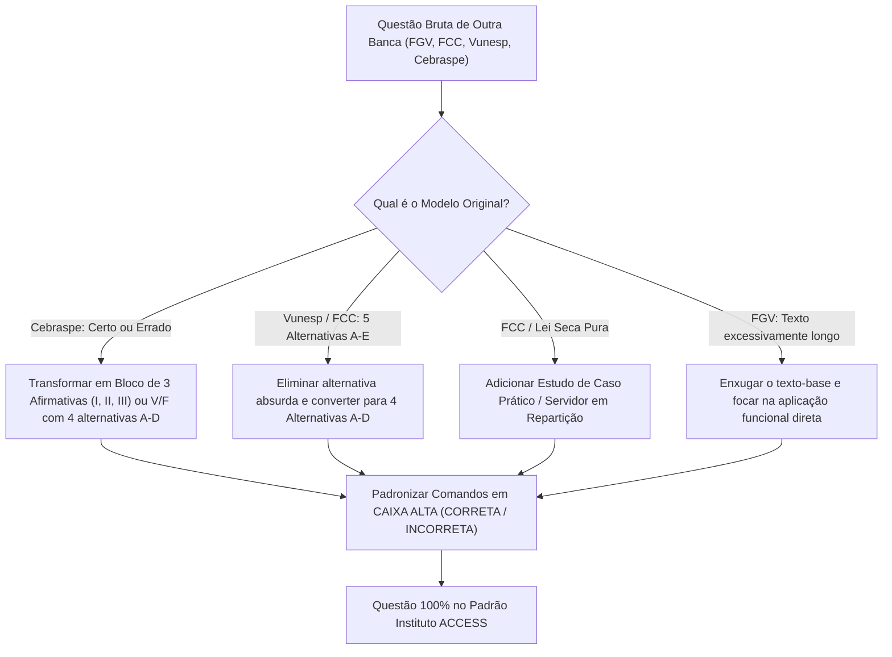

# 🏛️ MANUAL DO PADRÃO ESTRUTURAL DE QUESTÕES — BANCA INSTITUTO ACCESS
> **Documento Oficial de Engenharia Reversa e Adaptação de Questões**  
> **Base de Varredura:** 23 Provas Reais Oficiais de Nível Médio/Administrativo (2023 a 2026) — Mais de 1.035 questões analisadas minuciosamente.  
> **Finalidade:** Servir como matriz mestre para elaboração, formatação e adaptação perfeita de qualquer questão de concurso para o estilo, linguagem e diagramação do **Instituto ACCESS**.

---

## 1. O "DNA" do Instituto ACCESS: Visão Panorâmica

O Instituto ACCESS possui uma identidade muito bem definida, que se distancia tanto da decoreba crua e seca de bancas municipais menores quanto da prolixidade filosófica e ambígua da FGV. 

A banca busca um equilíbrio: **avaliação técnica aplicada ao cotidiano do serviço público com enunciados bem contextualizados e comandos tipograficamente rigorosos**.

### Estatísticas e Características Gerais da Amostragem (1.035 questões):
* **Número de Alternativas:**
  * **Concursos Municipais (Prefeituras e Câmaras — ex: Birigui, Cataguases, Promissão, Passos, Contagem):** **4 Alternativas (A, B, C, D)** em mais de **73% dos casos**. É o padrão direto para o cargo de Oficial Administrativo.
  * **Concursos Federais e Conselhos (ex: UFFS, UFAC, UNIPAMPA, CRBio):** **5 Alternativas (A, B, C, D, E)** em ~27% dos casos.
* **Tipografia e Padronização Visual dos Comandos:**
  * Palavras de comando negativo ou afirmativo vêm **SEMPRE EM CAIXA ALTA**: `CORRETA`, `INCORRETA`, `NÃO`, `EXCETO`, `FALSA`, `VERDADEIRO`.
  * Pontuação final do enunciado: normalmente finalizado com dois-pontos (`:`) ou ponto final (`.`).
* **Estilo de Linguagem:**
  * Formal, clara, culta e sem pegadinhas de dubiedade textual.
  * Os distratores (opções erradas) são inteligentes e plausíveis, baseados em inversões de conceitos, extrapolações ou troca sutil de palavras restritivas (*"exclusivamente"*, *"sempre"*, *"qualquer"*).

---

## 2. Os 5 Formatos Canônicos de Questões da ACCESS

Ao criar ou adaptar questões para a ACCESS, deve-se utilizar obrigatoriamente um destes cinco formatos:

```
┌────────────────────────────────────────────────────────────────────────┐
│               OS 5 FORMATOS DE QUESTÃO DA BANCA ACCESS                 │
├────────────────────────────────┬───────────────────────────────────────┤
│ 1. Múltipla Escolha Direta     │ Contexto + Pergunta objetiva (A a D)  │
│ 2. Julgamento de Itens Romanos │ I, II, III -> "Estão corretas apenas" │
│ 3. Verdadeiro ou Falso (V/F)   │ ( ) Julgamento com sequência no final │
│ 4. Associação de Colunas       │ Coluna I e Coluna II (1-4 -> A, B...) │
│ 5. Preenchimento de Lacunas    │ Trecho com ______ e termos sucessivos │
└────────────────────────────────┴───────────────────────────────────────┘
```

---

### FORMATO 1: Múltipla Escolha Direta Contextualizada (Comando Positivo ou Negativo)
* **Frequência:** ~65% a 70% da prova.
* **Mecânica:** Apresenta um trecho do texto, uma situação prática do órgão ou um dispositivo legal e exige a identificação direta da opção correta ou do erro (`INCORRETA` / `EXCETO`).
* **Estrutura Visual:**
```text
[Contextualização / Trecho entre aspas / Situação da Repartição]
Com base nas normas aplicáveis / Considerando a regência verbal / De acordo com as disposições legais, assinale a alternativa CORRETA [ou INCORRETA]:
(A) Opção 1...
(B) Opção 2...
(C) Opção 3...
(D) Opção 4...
```

---

### FORMATO 2: Julgamento de Afirmativas em Algarismos Romanos (I, II, III)
* **Frequência:** ~15% da prova (muito frequente em Português - Interpretação, RLM e Administração Geral/Pública).
* **Mecânica:** Apresenta 2 a 4 proposições analíticas. As alternativas combinam quais itens são válidos.
* **Opções de Resposta Padronizadas pela ACCESS:**
```text
A respeito de [Tema / Texto], analise as afirmativas a seguir:
I. [Afirmativa I]
II. [Afirmativa II]
III. [Afirmativa III]

Está(ão) correta(s):
(A) apenas a afirmativa I.
(B) apenas as afirmativas I e II.
(C) apenas as afirmativas II e III.
(D) todas as afirmativas.
```
*(Nota: a banca também varia para "Assinale a alternativa correta:" tendo como opções "Apenas o item II é verdadeiro", etc.)*

---

### FORMATO 3: Julgamento Verdadeiro ou Falso (V ou F) com Sequência
* **Frequência:** ~3% a 5% da prova.
* **Mecânica:** O candidato atribui V ou F a 3 ou 4 itens delimitados por `(__)` ou `( )`. As alternativas apresentam a sequência correspondente.
* **Estrutura Visual:**
```text
No contexto de [Tema], avalie as assertivas a seguir e assinale V (verdadeiro) ou F (falso):
(__) [Afirmativa 1].
(__) [Afirmativa 2].
(__) [Afirmativa 3].

A sequência correta, de cima para baixo, é:
(A) V – F – V.
(B) V – V – F.
(C) F – V – V.
(D) F – F – V.
```

---

### FORMATO 4: Associação de Colunas (Coluna I e Coluna II)
* **Frequência:** Presente em praticamente toda prova da ACCESS (especialmente em Noções de Administração, Arquivologia, Legislação e Geografia).
* **Mecânica:** Coluna I traz termos, órgãos, princípios ou leis numerados (1 a 4). Coluna II traz definições com parênteses em branco `( )`.
* **Estrutura Visual:**
```text
Relacione os conceitos da Coluna I com as suas respectivas características na Coluna II:

Coluna I:
1. Eficiência.
2. Impessoalidade.
3. Moralidade.
4. Publicidade.

Coluna II:
( ) Exige atuação ética, honesta e de boa-fé no trato com a coisa pública.
( ) Impõe transparência e divulgação oficial dos atos para controle social.
( ) Visa ao melhor rendimento funcional e otimização dos recursos públicos.
( ) Veda a promoção pessoal de autoridades sobre as realizações da Administração.

A sequência correta da Coluna II, de cima para baixo, é:
(A) 3 – 4 – 1 – 2.
(B) 2 – 1 – 4 – 3.
(C) 3 – 1 – 4 – 2.
(D) 4 – 3 – 2 – 1.
```

---

### FORMATO 5: Preenchimento de Lacunas Contextualizadas
* **Frequência:** Ocorre principalmente em Morfologia (conjunções/preposições), Regência/Crase e redação técnica.
* **Mecânica:** Período com duas ou três lacunas para preencher na ordem exata.
* **Comando Padrão:**
```text
Assinale a alternativa que preenche, correta e respectivamente, as lacunas do período acima:
(A) à — por que — onde
(B) a — porque — em que
(C) à — porquê — cujo
(D) a — por isso — o qual
```

---

## 3. Radiografia por Disciplina: Como a ACCESS Estrutura Cada Matéria

### 3.1. Língua Portuguesa
1. **O Texto-Base:**
   * A ACCESS **sempre** utiliza textos de apoio reais: crônicas literárias, artigos de jornais de grande circulação (Folha, Estadão, El País) ou artigos de divulgação científica (temas como arqueologia, astronomia, neurociência, avanços tecnológicos e meio ambiente).
   * Uma prova de 10 questões geralmente conta com **1 texto longo** (40-60 linhas) para as 10 questões, ou **2 textos médios** (questões 1 a 5 no Texto 1; 6 a 10 no Texto 2).
2. **Questões de Compreensão e Interpretação:**
   * Cobra **inferência textual** e **informações implícitas** (subentendidos e pressupostos). Raramente faz perguntas literais ("qual a cor do cavalo?"). Usa fórmulas como: *"O texto pressupõe que..."*, *"A respeito das ideias do texto, analise as afirmativas..."*.
3. **Questões de Gramática Aplicada:**
   * A gramática da ACCESS **nunca é abstrata**. Ela recorta um período ou oração do texto-base entre aspas, indicando a linha ou o contexto:
     * *"Em relação à concordância nominal no período, analise as afirmações e assinale a alternativa CORRETA."*
     * *"Com base nas regras de regência verbal, é correto afirmar que o verbo destacado é..."*
     * *"Assinale a alternativa em que se tenha feito pontuação igualmente correta para o período acima."*
     * *"Assinale a alternativa que pode substituir o conectivo sublinhado sem alteração de sentido."*

---

### 3.2. Raciocínio Lógico e Matemático
1. **Personificação e Casos Cotidianos:**
   * A ACCESS quase não faz questões secas de cálculo puro do tipo `Resolva: 3x + 5 = 20`.
   * Ela **sempre personifica com nomes próprios e ambientes de trabalho**:
     * *"Carlos tem 60 pastas e quer dividir entre seus 3 estagiários de forma diretamente proporcional às suas idades: 19, 21 e 25 anos..."*
     * *"Para realizar a manutenção preventiva de dois servidores em um galpão industrial, um técnico precisa se deslocar do Ponto A (1, 2) até o Ponto B (6, 14)..."*
     * *"Cinco colegas de repartição (Ana, Bruno, Carlos, Daniela e Eduardo) chegam em horários distintos..."*
2. **Lógica de Dedução e Associação Lógica (Quebra-Cabeças):**
   * Ama problemas de correlacionar pessoas, funções, cores de pastas, salas ou veículos.
3. **Sequências Alfanuméricas:**
   * Sequências de letras baseadas na posição do alfabeto (`D, H, K, O, R...`), alternando saltos numéricos.
4. **Matemática Aplicada:**
   * Frações, porcentagem cumulativa, regra de três composta, progressão aritmética (P.A.) em produtividade diária e geometria prática (cálculo de capacidade em litros de caixas-d'água ou salas retangulares com alteração percentual de medidas).

---

### 3.3. Conhecimentos Específicos (Administração Pública, Rotinas e Legislação)
1. **O Método "Estudo de Caso da Repartição Pública":**
   * Esta é a **marca mais forte da banca ACCESS**. Em vez de perguntar a definição fria de um conceito, ela cria um servidor fictício em apuros ou executando uma tarefa:
     * *"Durante auditoria interna em um órgão público municipal, foram analisados expedientes oficiais..."*
     * *"Em uma unidade de atendimento ao cidadão, um escriturário é responsável pela triagem..."*
     * *"Um estado da federação instituiu, por meio de lei específica, uma fundação pública com personalidade jurídica de direito privado..."*
     * *"João, servidor lotado no setor de compras, deparou-se com a necessidade de realizar contratação direta nos termos da Lei nº 14.133/2021..."*
2. **Estrutura Organizacional e Organogramas:**
   * A ACCESS cobra frequentemente tipos de organogramas (vertical, horizontal, circular, matricial) e departamentalização (por funções, clientes, produtos, territorial), avaliando prós e contras na cadeia de comando.
3. **Gestão Documental, Protocolo e Arquivologia:**
   * As operações de protocolo (*recepção, registro, autuação, classificação, expedição*) e as três idades documentais (*corrente, intermediário, permanente*) são cobradas aplicadas à rotina de eliminação, guarda ou referência cruzada.
4. **Redação Oficial:**
   * Totalmente alinhada ao *Manual de Redação da Presidência da República (3ª edição)*: partes do documento padrão ofício, uso de pronomes de tratamento (*Vossa Excelência* vs. *Vossa Senhoria*), fechos para comunicações (*Respeitosamente* vs. *Atenciosamente*) e características fundamentais (clareza, impessoalidade, concisão, formalidade).

---

### 3.4. Conhecimentos Gerais (História, Geografia, Meio Ambiente e Atualidades)
1. **Escala Tripla (Local $\leftrightarrow$ Regional $\leftrightarrow$ Global):**
   * Em concursos municipais, a ACCESS sempre mescla:
     * **História e Geografia Local:** Emancipação do município, fundadores, rodovias de acesso, relevo, hidrografia, economia motriz (ex.: calçados em Birigui, agricultura regional).
     * **Cenário Nacional e Global:** Transição energética, debates climáticos na Amazônia, agronegócio e tecnologia (drones, agricultura de precisão), políticas públicas de saúde e inflação/taxa de juros.
2. **Estilo do Enunciado:**
   * Enunciados analíticos de 3 a 5 linhas contextualizando o fato histórico ou o desafio socioeconômico contemporâneo antes de demandar a resposta.

---

## 4. Engenharia de Distratores da ACCESS: Como a Banca Constrói os Erros

Ao adaptar ou redigir questões, você deve incorporar os padrões de "pegadinhas" que o Instituto ACCESS realmente utiliza:

| Tipo de Distrator ACCESS | Mecânica Utilizada pela Banca | Exemplo Real / Típico |
| :--- | :--- | :--- |
| **Inversão de Polos Conceituais** | Troca direta entre dois conceitos correlatos da mesma matéria. | Trocar *desconcentração* (criação de órgãos dentro da mesma pessoa) por *descentralização* (criação de novas entidades). |
| **Generalização / Palavras Extremas** | Inserção de advérbios absolutistas em regras que possuem exceção legal. | Adicionar palavras como *"em qualquer hipótese"*, *"exclusivamente"*, *"sempre sob pena de nulidade"*. |
| **Falsa Correspondência Sintática** | No português, induzir o erro de regência por meio de preposições presentes em termos acessórios vizinhos. | Afirmar que o verbo *exibe* é transitivo indireto porque logo após há a locução *"revestida por"*. |
| **Mistura de Fases do Ciclo Documental** | Atribuir características da fase corrente ao arquivo intermediário ou permanente. | Afirmar que o arquivo permanente pode descartar documentos de valor histórico após 5 anos. |
| **Inversão de Destinatário de Fecho** | Trocar o destinatário dos fechos oficiais da Redação Oficial. | Usar *"Respeitosamente"* para autoridades de mesma hierarquia ou *"Atenciosamente"* para autoridades superiores. |

---

## 5. Matriz de Adaptação: O Algoritmo de Conversão de Questões

Quando precisarmos utilizar questões de outras bancas do nosso acervo de 81 provas diárias (FGV, FCC, VUNESP, CEBRASPE, IBFC), **devemos executar este algoritmo de transformação**:



---

### Exemplo Prático 1: Adaptando Questão Seca de Legislação (Padrão FCC/Lei Seca) para o Padrão ACCESS

#### ❌ Questão Original (Banca Genérica / Decoreba de Lei Seca):
> **Assunto:** Lei nº 14.133/2021 (Inexigibilidade de Licitação)  
> Assinale a alternativa que indica uma hipótese de inexigibilidade de licitação:  
> (A) Obras e serviços de engenharia até o valor de R$ 100.000,00.  
> (B) Contratação de profissional do setor artístico, diretamente ou por meio de empresário exclusivo, desde que consagrado pela crítica especializada ou pela opinião pública.  
> (C) Casos de emergência ou de calamidade pública.  
> (D) Intervenção da União no domínio econômico para regular preços.  
> (E) Contratação de instituição brasileira que tenha por finalidade o desenvolvimento institucional.

#### 🔄 Transformação ACCESS (Estudo de Caso Prático na Prefeitura + 4 Alternativas + Termo em Caixa Alta):
> ### Questão Adaptada (Padrão Instituto ACCESS)
> **Banca:** Adaptada para o Padrão Instituto ACCESS | **Cargo:** Oficial Administrativo  
> **Assunto:** Licitações e Contratos Administrativos (Lei nº 14.133/2021)  
> 
> Durante o planejamento dos eventos culturais em comemoração ao aniversário de emancipação do município, o Secretário Municipal de Cultura solicitou a contratação direta de um músico regional de renome, amplamente consagrado pela crítica e pelo público local, para a realização do show principal. O servidor responsável pelo setor de contratações deve enquadrar a solicitação em conformidade com as regras da Nova Lei de Licitações (Lei nº 14.133/2021).  
> 
> Considerando a situação hipotética e as disposições legais vigentes, assinale a alternativa CORRETA:  
> (A) A contratação pretendida caracteriza hipótese de inexigibilidade de licitação, tendo em vista a inviabilidade de competição para serviços artísticos consagrados pela crítica especializada ou pela opinião pública.  
> (B) A contratação configura hipótese de dispensa de licitação em razão do valor, desde que o cachê do artista não ultrapasse o limite regulamentar previsto para compras e serviços gerais.  
> (C) O procedimento licitatório é obrigatório na modalidade leilão, sendo vedada qualquer forma de contratação direta de artistas pela Administração Pública Municipal.  
> (D) A situação apresentada configura hipótese de licitação dispensada, sendo exigida autorização legislativa prévia da Câmara de Vereadores para a formalização do contrato.  
> 
> <details>
> <summary><b>Ver Gabarito e Comentário Detalhado</b></summary>
> 
> **Gabarito Oficial: A**  
> * **Comentário:** Nos exatos termos do art. 74, inciso II, da Lei nº 14.133/2021, é inexigível a licitação quando inviável a competição, em especial para a contratação de profissional do setor artístico, diretamente ou por meio de empresário exclusivo, desde que consagrado pela crítica especializada ou pela opinião pública.
> </details>

---

### Exemplo Prático 2: Adaptando Questão Cebraspe (Certo/Errado) para o Padrão ACCESS

#### ❌ Questões Originais Cebraspe (3 Itens Certo/Errado Soltos):
> 1. A descentralização administrativa pressupõe a criação de uma nova pessoa jurídica para o exercício de competências estatais. ( )  
> 2. A desconcentração ocorre exclusivamente entre entidades de pessoas jurídicas distintas. ( )  
> 3. Na descentralização por serviços, o Poder Público cria uma entidade e a ela transfere a titularidade e a execução de determinado serviço público. ( )

#### 🔄 Transformação ACCESS (Modelo Itens Romanos I, II, III com 4 Alternativas):
> ### Questão Adaptada (Padrão Instituto ACCESS)
> **Banca:** Adaptada para o Padrão Instituto ACCESS | **Cargo:** Oficial Administrativo  
> **Assunto:** Organização Administrativa (Descentralização vs. Desconcentração)  
> 
> A organização da Administração Pública brasileira envolve técnicas de distribuição de competências destinadas a otimizar a prestação dos serviços públicos e a gestão estatal. A respeito dos conceitos de descentralização e desconcentração administrativa, analise as afirmativas a seguir:  
> 
> I. A descentralização administrativa pressupõe a distribuição de competências para outra pessoa jurídica, distinta do ente político central.  
> II. A desconcentração administrativa ocorre exclusivamente entre entidades de pessoas jurídicas distintas, rompendo qualquer relação hierárquica.  
> III. Na descentralização por serviços ou funcional, o Poder Público cria uma entidade integrante da Administração Indireta e a ela transfere a titularidade e a execução de determinado serviço público.  
> 
> Está(ão) CORRETA(S):  
> (A) apenas a afirmativa I.  
> (B) apenas a afirmativa II.  
> (C) apenas as afirmativas I e III.  
> (D) todas as afirmativas.  
> 
> <details>
> <summary><b>Ver Gabarito e Comentário Detalhado</b></summary>
> 
> **Gabarito Oficial: C**  
> * **Comentário:**  
>   - O item I está correto: a descentralização pressupõe duas pessoas jurídicas distintas.  
>   - O item II está incorreto: a desconcentração é uma distribuição interna de competências dentro da MESMA pessoa jurídica (criação de órgãos), mantendo o vínculo hierárquico.  
>   - O item III está correto: trata-se da descentralização por serviços (outorga), onde se transfere titularidade e execução (ex.: criação de autarquias).
> </details>

---

## 6. Checklist de Validação do Agente (Garantia de Qualidade Padrão ACCESS)

Antes de entregar qualquer bateria de questões, simulado ou adaptação, o Agente IA deve passar por este checklist de 6 pontos:

- [ ] **1. Contagem de Alternativas:** O concurso é municipal/prefeitura? Se sim, **exatamente 4 alternativas (A, B, C, D)**. Se for federal/conselho regional, 5 alternativas (A-E).
- [ ] **2. Grafia do Comando:** Termos como `CORRETA`, `INCORRETA`, `EXCETO` ou `NÃO` estão em **CAIXA ALTA**?
- [ ] **3. Contextualização Funcional:** Nas questões específicas de administração e rotinas, foi criado um **caso prático verossímil de repartição pública** em vez de decoreba fria?
- [ ] **4. Personificação em RLM:** Os enunciados matemáticos e lógicos usam nomes próprios, ambientes cotidianos ou problemas relacionais?
- [ ] **5. Formatação dos Distratores:** As alternativas incorretas exploram inversões conceituais lógicas (conforme Seção 4), evitando respostas esdrúxulas ou infantis?
- [ ] **6. Tag do Site Interativo:** A questão possui o bloco `### Questão XX`, alternativas `- **A)**` ou `(A)` e o `<details><summary><b>Ver Gabarito e Comentário Detalhado</b></summary> ... </details>` para rodar no script de formulário interativo (`sync_lessons.py`)?
