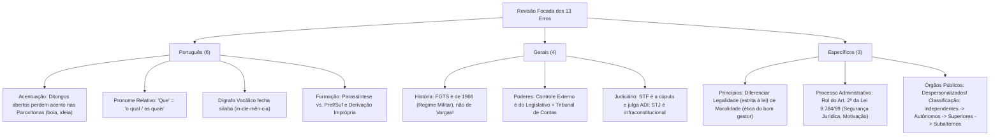

# 🎯 Caderno de Erros e Revisão de Conceitos — Simulado Semanas 01 e 02
**Cargo Alvo:** Oficial Administrativo | **Banca Foco:** Instituto ACCESS, VUNESP e Similares  
**Data do Simulado:** 08/11/2026 | **Aproveitamento Geral:** 43 Acertos em 56 Respondidas (**76,8% de Eficiência**)

---

## 📊 Raio-X do Seu Desempenho

| Disciplina | Questões | Respondidas | Acertos | Erros | Aproveitamento | Status |
| :--- | :---: | :---: | :---: | :---: | :---: | :---: |
| 📚 **Língua Portuguesa** | 18 | 18 | **12** | 6 | **66,7%** | ⚠️ Revisar Morfologia e Acentuação |
| 🧮 **Raciocínio Lógico & Mat.** | 18 | 0 | — | — | — | ⏳ Deixado em branco para depois |
| 🌍 **Conhecimentos Gerais** | 18 | 18 | **14** | 4 | **77,8%** | 🟢 Muito Bom (Ajustar detalhes de Poderes) |
| ⚖️ **Conhecimentos Específicos** | 20 | 20 | **17** | 3 | **85,0%** | 🔥 Excelente (Ajustar Teoria dos Órgãos) |
| **TOTAL CONSOLIDADO** | **74** | **56** | **43** | **13** | **76,8%** | **Consistência Alta** |

---

# 📚 LÍNGUA PORTUGUESA (6 Erros Mapeados)

---

### 1. Questão 04 — Tonicidade, Acentuação Gráfica e Novo Acordo
* **Tópico do Edital:** Acentuação Gráfica (Regras Gerais, Ditongos Abertos e Acento Diferencial)
* **Sua Resposta:** Letra **A** | **Gabarito Oficial:** Letra **B**
* **Tipo de Pegadinha:** Comando pedindo a alternativa **INCORRETA**.
* 🔍 **Onde esteve a falha:**
  A alternativa **B** afirmava falsamente que o vocábulo *"bóia"* seria uma oxítona e que teria mantido o acento agudo. Na realidade:
  * *"Boia"* (`boi-a`) é palavra **paroxítona** com ditongo aberto `oi` na penúltima sílaba.
  * Com o Novo Acordo Ortográfico, os ditongos abertos `ei` e `oi` das **paroxítonas** perderam o acento agudo (*ideia, boia, assembleia, heroico, estreia, paranoico*).
  * Apenas as **oxítonas** e monossílabos tônicos mantêm o acento (*herói, heróis, troféu, chapéu, dói*).
* 💡 **Pílula Conceitual / Regra de Ouro:**
  > **Ditongo aberto `ei`/`oi`:**
  > * Na penúltima sílaba (**paroxítona**) $\to$ **SEM ACENTO** (*i-dei-a*, *co-rrei-a*, *boi-a*).
  > * Na última sílaba (**oxítona**) $\to$ **COM ACENTO** (*he-rói*, *pa-péis*, *tro-féu*).
  > * **Acento diferencial mantido:** *Pôr* (verbo) vs. *por* (preposição); *pôde* (pretérito) vs. *pode* (presente).

---

### 2. Questão 07 — Morfologia: Pronome Relativo vs. Conjunção Integrante / Indefinido
* **Tópico do Edital:** Classes de Palavras (Pronomes) e Coesão Referencial
* **Sua Resposta:** Letra **B** (Pronome indefinido) | **Gabarito Oficial:** Letra **A** (Pronome relativo)
* **Trecho Analisado:** *"Isso é particularmente relevante em investigações clínicas **que** buscam identificar coágulos..."*
* 🔍 **Onde esteve a falha:**
  Você classificou o vocábulo `que` como pronome indefinido. Para classificar a palavra `que`, aplica-se o teste da substituição:
  1. O termo antecedente é um substantivo (*investigações clínicas*).
  2. Podemos comutar por *"as quais"*: *"investigações clínicas **as quais** buscam..."*.
  3. Logo, exerce função anafórica de **Pronome Relativo**, introduzindo oração subordinada adjetiva restritiva.
* 💡 **Pílula Conceitual / Regra de Ouro:**
  > * **Substitui por "O QUAL / A QUAL / OS QUAIS / AS QUAIS"?** $\to$ É **Pronome Relativo** (liga a substantivo antecedente).
  > * **Substitui a oração inteira por "ISSO"?** (*"Quero que você venha" $\to$ "Quero isso"*) $\to$ É **Conjunção Integrante** (liga a verbo).

---

### 3. Questão 10 — Fonologia: Divisão Silábica, Encontros Vocálicos e Translineação
* **Tópico do Edital:** Divisão Silábica e Fonética
* **Sua Resposta:** Letra **C** | **Gabarito Oficial:** Letra **B**
* **Tipo de Pegadinha:** Comando pedindo a afirmativa **INCORRETA**.
* 🔍 **Onde esteve a falha:**
  A alternativa **B** afirmava que em *"inclemência"* a letra `n` poderia iniciar a sílaba seguinte.
  * O `n` após a vogal `e` não é consoante autônoma: forma o **dígrafo vocálico** `en` (marca de nasalização).
  * O dígrafo vocálico fecha a sílaba e jamais pode ser cindido para abrir a sílaba subsequente diante de consoante: a partição correta é `in-cle-mên-ci-a` (ou `in-cle-mên-cia`).
* 💡 **Pílula Conceitual / Regra de Ouro:**
  > As letras `m` e `n` em final de sílaba indicando vogal nasal (*tam-pa, can-to, len-ço, in-cle-mên-cia*) **pertencem à sílaba da vogal que nasalizam**; nunca passam para a sílaba seguinte na translineação.

---

### 4. Questão 13 — Morfologia: Adjetivo, Locução Adjetiva e Correspondência Semântica
* **Tópico do Edital:** O Substantivo e seus Satélites (Adjetivos e Locuções Adjetivas)
* **Sua Resposta:** Letra **A** (Afirmativas I e II) | **Gabarito Oficial:** Letra **C** (Afirmativas I e III)
* 🔍 **Onde esteve a falha:**
  O item **II** continha uma armadilha semântica sutil: afirmava que a locução adjetiva *"do ânimo"* equivaleria ao adjetivo *"animal"*.
  * *"Ânimo"* (do latim *animus* = alma, mente, disposição psíquica) tem como adjetivo culto correspondente **anímico** (*característica anímica*).
  * *Animal* refere-se à matéria viva zoológica ou irracional, alterando totalmente o sentido.
  * O item **III** estava perfeito: *"magno"* e *"chinesa"* são adjetivos, e em *"que talento tinha para crueldade"* `crueldade` é substantivo abstrato preposicionado (não há adjetivo).
* 💡 **Pílula Conceitual / Regra de Ouro:**
  > Fique atento a correspondências eruditas da banca ACCESS:
  > * Do ânimo / da alma $\to$ **Anímico**
  > * De prata $\to$ **Argênteo**
  > * De chumbo $\to$ **Plúmbeo**
  > * De bispo $\to$ **Episcopal**
  > * De guerra $\to$ **Bélico**

---

### 5. Questão 17 — Estrutura e Formação de Palavras: Derivação Sufixal
* **Tópico do Edital:** Processos de Formação de Palavras (Derivação e Composição)
* **Sua Resposta:** Letra **D** (*primavera*) | **Gabarito Oficial:** Letra **C** (*operário*)
* 🔍 **Onde esteve a falha:**
  * *Primavera* não é derivada por sufixação: etimologicamente é uma palavra composta (*prima* + *vera* = primeiro verão).
  * O vocábulo **operário** é formado por **derivação sufixal**: radical nominal `oper-` (do latim *opus, operis* = obra, trabalho) + sufixo nominal `-ário` (indicador de agente / ocupação profissional).
* 💡 **Pílula Conceitual / Regra de Ouro:**
  > O sufixo `-ário(a)` forma nomes de profissões e ocupações a partir de radicais nominais:
  > * Obra $\to$ **Operário**
  > * Banco $\to$ **Bancário**
  > * Segredo $\to$ **Secretário**
  > * Livro $\to$ **Livrário / Livreiro**

---

### 6. Questão 18 — Processos de Formação: Parassíntese vs. Conversão (Derivação Imprópria)
* **Tópico do Edital:** Morfologia Estrutural e Formação do Vocábulo
* **Sua Resposta:** Letra **C** (I e II) | **Gabarito Oficial:** Letra **D** (I, II e III corretas)
* 🔍 **Onde esteve a falha:**
  Você julgou o item **III** incorreto, mas todas as três proposições eram verdadeiras:
  1. *Enriquecer* é parassíntese: `en- + riqu- + -ecer` (não existem *"enrico"* nem *"riquecer"* isoladamente).
  2. *Infelizmente* é derivação prefixal e sufixal não simultânea (existem *"infeliz"* e *"felizmente"*).
  3. Em *"A troca ocorre através **do olhar**"*, o infinitivo verbal `olhar` foi substantivado pelo artigo `o` $\to$ processo clássico de **Derivação Imprópria** (ou conversão). E *planalto* (plano + alto) e *aguardente* (água + ardente) são casos legítimos de **Composição por Aglutinação**.
* 💡 **Pílula Conceitual / Regra de Ouro:**
  > * **Teste do Descarte (Parassíntese vs. Pref/Suf):** Tire o prefixo; a palavra continuou existindo? Se sim $\to$ Pref + Suf (*deslealdade $\to$ lealdade*). Se a palavra NÃO existe sem um dos dois $\to$ **Parassíntese** (*envernizar, enriquecer, anoitecer*).
  > * **Derivação Imprópria:** A palavra muda de classe gramatical sem sofrer qualquer alteração na sua forma gráfica (*"o jantar", "o falar", "o não"*, adjetivo virando advérbio: *"falou alto"*).

---

# 🌍 CONHECIMENTOS GERAIS (4 Erros Mapeados)

---

### 7. Questão 42 — História do Brasil: República Velha vs. Era Vargas (1930–1945)
* **Tópico do Edital:** História do Brasil Republicano, Estrutura Eleitoral e Legislação Social
* **Sua Resposta:** Letra **D** (I, II e III) | **Gabarito Oficial:** Letra **B** (Apenas I e II)
* 🔍 **Onde esteve a falha:**
  Você considerou o item **III** como correto. Ele trazia duas grandes mentiras históricas muito cobradas em concursos:
  1. Afirmava que o **FGTS** foi criado por Getúlio Vargas em 1943. **Falso:** o FGTS só foi instituído em **1966** (Lei nº 5.107/1966, durante o Regime Militar) para extinguir a antiga estabilidade decenal da CLT.
  2. Afirmava que Vargas concedeu total liberdade e autonomia aos sindicatos operários. **Falso:** o modelo sindical varguista (inspirado na *Carta del Lavoro* italiana) era de **tutela corporativista**, atrelando os sindicatos ao Ministério do Trabalho.
* 💡 **Pílula Conceitual / Regra de Ouro:**
  > * **Era Vargas (1943 - CLT):** Salário mínimo, férias remuneradas, jornada de 8h, carteira de trabalho $\to$ porém com **sindicatos tutelados pelo Estado**.
  > * **FGTS:** Criado em **1966** (não foi Vargas!).
  > * **República Velha (1889–1930):** Voto aberto (CF 1891) $\to$ coronelismo, voto de cabresto e comissão verificadora da degola.

---

### 8. Questão 49 — Três Poderes: Atribuições do Executivo vs. Controle Externo do Legislativo
* **Tópico do Edital:** Organização dos Poderes (CF/88, Arts. 70, 71 e 84)
* **Sua Resposta:** Letra **A** | **Gabarito Oficial:** Letra **E**
* **Tipo de Pegadinha:** Questão pedindo a exceção (*"à exceção de uma"*).
* 🔍 **Onde esteve a falha:**
  A alternativa **A** (*iniciar o processo legislativo*) é atribuição típica e expressa do Chefe do Executivo (art. 84, III, da CF/88 — iniciativa privativa ou concorrente de leis).
  A exceção real era a letra **E**: **realizar o controle externo das contas públicas**.
  * O controle externo da Administração é competência titular do **Poder Legislativo** (Congresso Nacional / Câmaras Municipais), exercido com o auxílio técnico do **Tribunal de Contas** (art. 70 e 71 da CF/88).
* 💡 **Pílula Conceitual / Regra de Ouro:**
  > * **Controle Interno:** Feito pelo próprio Poder Executivo sobre seus órgãos (Controladoria-Geral).
  > * **Controle Externo:** Feito pelo **Poder Legislativo** auxiliado pelo **Tribunal de Contas**. O Chefe do Executivo presta as contas, mas quem as julga/controla externamente é o Legislativo!

---

### 9. Questão 50 — Poder Judiciário: Estrutura, Cúpula e Controle de Constitucionalidade
* **Tópico do Edital:** Estrutura e Competências do Poder Judiciário (CF/88, Arts. 92, 102 e 105)
* **Sua Resposta:** Letra **C** | **Gabarito Oficial:** Letra **A** (Apenas a afirmativa I está correta)
* 🔍 **Onde esteve a falha:**
  * O item **I** está correto: conforme o art. 92, III, da CF/88, os Juízes Federais são **órgãos do Poder Judiciário** (órgãos judiciais de 1º grau).
  * O item **II** é falso: o órgão mais alto da Justiça brasileira é o **STF** (Supremo Tribunal Federal), e não o STJ.
  * O item **III** é falso: quem julga as Ações Diretas de Inconstitucionalidade (ADIs) é originária e exclusivamente o **STF** (art. 102, I, `a`, da CF/88), e não o STJ.
* 💡 **Pílula Conceitual / Regra de Ouro:**
  > * **STF (11 Ministros):** Cúpula do Judiciário e guardião da **Constituição** (julga ADI, ADC, ADPF e Recurso Extraordinário).
  > * **STJ (33 Ministros):** Guardião da **legislação federal infraconstitucional** (julga Recurso Especial).
  > * **Juízes singulares são órgãos:** Sim! Cada juiz ou juízo em exercício da jurisdição é classificado tecnicamente como órgão público unipessoal do Judiciário.

---

### 10. Questão 54 — Cidadania, Ética e Democracia
* **Tópico do Edital:** Noções de Cidadania, Direitos Republicanos e Democracia
* **Sua Resposta:** Letra **A** | **Gabarito Oficial:** Letra **D**
* **Tipo de Pegadinha:** Comando pedindo a afirmativa **INCORRETA**.
* 🔍 **Onde esteve a falha:**
  A letra **D** sustentava que *"no exercício da cidadania, os valores éticos só merecem ser seguidos se a democracia for plena"*.
  * No regime republicano, o dever ético e a conduta cidadã são imperativos categóricos e incondicionais;
  * É exatamente nos períodos em que as instituições falham ou a democracia é posta em desafio que a postura vigilante e íntegra do cidadão se faz indispensável.
* 💡 **Pílula Conceitual / Regra de Ouro:**
  > Em questões da banca ACCESS sobre ética e cidadania: desconfie sempre de alternativas que condicionem o respeito às leis, a probidade ou a ética à perfeição do sistema ou ao comportamento de terceiros. A ética pública e cidadã é incondicional.

---

# ⚖️ CONHECIMENTOS ESPECÍFICOS (3 Erros Mapeados)

---

### 11. Questão 58 — Princípios da Administração Pública: Associação de Colunas
* **Tópico do Edital:** Princípios Constitucionais (LIMPE e Princípios Implícitos)
* **Sua Resposta:** Letra **A** | **Gabarito Oficial:** Letra **B** (Sequência: 1 – 4 – 2 – 3)
* 🔍 **Onde esteve a falha:**
  A questão exigia associar 4 princípios com suas definições clássicas:
  1. *Prática de atos voltados exclusivamente ao interesse público* $\to$ **1. Finalidade**
  2. *Dever de divulgar atos e contratos oficiais* $\to$ **4. Publicidade**
  3. *Atividade vinculada aos mandamentos da lei sob pena de invalidade* $\to$ **2. Legalidade**
  4. *Atos intimamente ligados ao conceito do bom administrador (ética/boa-fé)* $\to$ **3. Moralidade**
  Você inverteu a associação entre Legalidade e Moralidade.
* 💡 **Pílula Conceitual / Regra de Ouro:**
  > * **Legalidade:** O administrador só faz o que a lei **permite ou determina** (estrita submissão à lei, sob pena de nulidade).
  > * **Moralidade:** Não basta ser legal, tem que ser honesto, ético e leal; exige a conduta do **"bom administrador"** (probidade e boa-fé objetiva).
  > * **Finalidade:** O ato deve mirar unicamente o **interesse público primário**; desvio de finalidade gera nulidade absoluta.

---

### 12. Questão 60 — Princípios do Processo Administrativo (Lei Federal nº 9.784/1999)
* **Tópico do Edital:** Regime Jurídico Administrativo e Lei do Processo Administrativo
* **Sua Resposta:** Letra **A** | **Gabarito Oficial:** Letra **E**
* 🔍 **Onde esteve a falha:**
  Você marcou a letra **A**, mas nos termos literais do **art. 2º da Lei nº 9.784/1999**:
  * A Administração Pública obedece, entre outros, aos princípios: *legalidade, finalidade, motivação, razoabilidade, proporcionalidade, moralidade, ampla defesa, contraditório, segurança jurídica, interesse público e eficiência* (Letra **E**).
  * A motivação **não** pode ser dispensada na discricionariedade, e o contraditório e ampla defesa são garantias constitucionais inegociáveis.
* 💡 **Pílula Conceitual / Regra de Ouro:**
  > O rol do Art. 2º da Lei nº 9.784/1999 amplia o LIMPE constitucional, consagrando expressamente no processo administrativo:
  > * **Motivação:** A autoridade deve indicar os fatos e os fundamentos jurídicos de toda decisão restritiva ou discricionária.
  > * **Segurança Jurídica:** Veda a aplicação retroativa de nova interpretação jurídica da norma pela Administração.
  > * **Proporcionalidade e Razoabilidade:** Adequação entre meios e fins, vedada a imposição de obrigações em medida superior às necessárias.

---

### 13. Questão 64 — Organização Administrativa: Natureza e Classificação dos Órgãos Públicos
* **Tópico do Edital:** Administração Direta vs. Indireta; Teoria dos Órgãos e Hierarquia
* **Sua Resposta:** Letra **C** | **Gabarito Oficial:** Letra **D**
* 🔍 **Onde esteve a falha:**
  * Você marcou a letra **C**, que continha um erro crasso em Direito Administrativo: afirmava que os órgãos públicos teriam personalidade jurídica própria e que integrariam exclusivamente a Administração Indireta.
  * **Regra absoluta:** Órgão público **NÃO possui personalidade jurídica própria** (é centro de competências despersonalizado, criado por desconcentração). A personalidade jurídica pertence ao ente político (ex.: Município de Birigui).
  * A letra **D** estava perfeita ao abordar a classificação de Hely Lopes Meirelles quanto à posição estatal: os **órgãos independentes** situam-se no ápice da pirâmide (Chefia do Executivo e Câmara de Vereadores), previstos diretamente no texto constitucional e sem qualquer subordinação hierárquica a outro órgão.
* 💡 **Pílula Conceitual / Regra de Ouro:**
  > **Classificação dos Órgãos quanto à Posição Estatal:**
  > 1. **Independentes:** Cúpula constitucional, sem hierarquia superior (*Prefeito, Governador, Presidente, Câmaras, Tribunais*).
  > 2. **Autônomos:** Ampla autonomia técnica e financeira, subordinados apenas à cúpula (*Secretarias Municipais, Ministérios*).
  > 3. **Superiores:** Direção, chefia e controle de áreas específicas (*Departamentos, Coordenadorias*).
  > 4. **Subalternos:** Mera execução de tarefas rotineiras, reduzido poder decisório (*Protocolo Geral, Portaria, Zeladoria*).

---

## 🚀 Plano de Revisão Rápida para Blindagem

---
*Material consolidado automaticamente com base nas 56 respostas registradas na sua sessão de simulado.*
