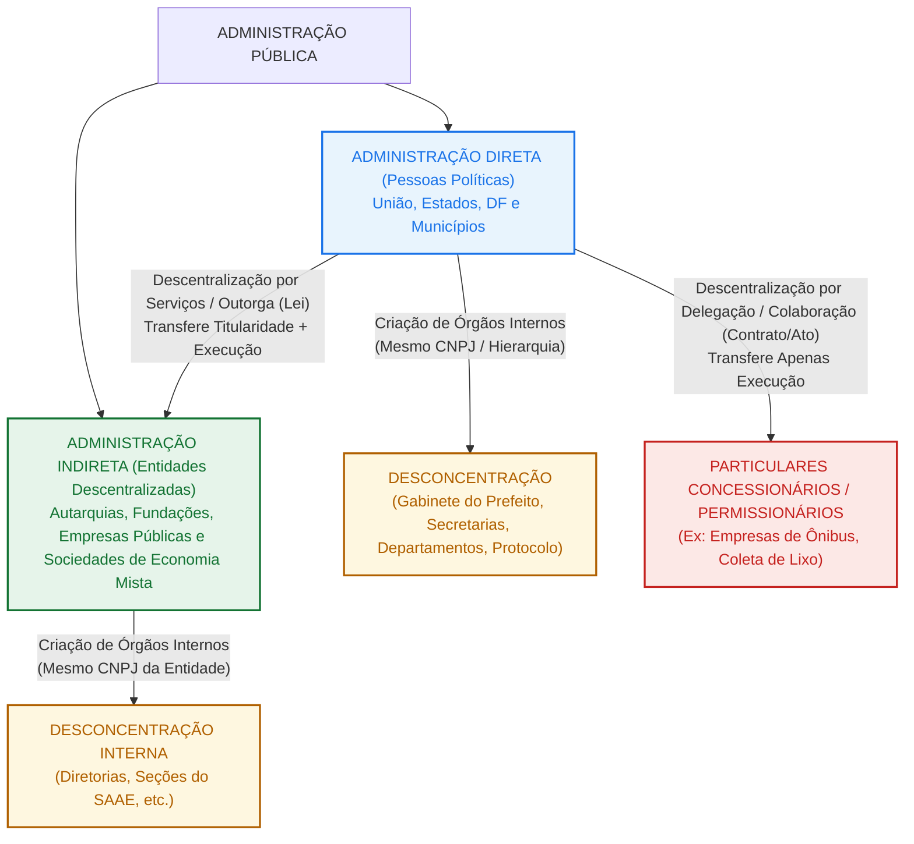
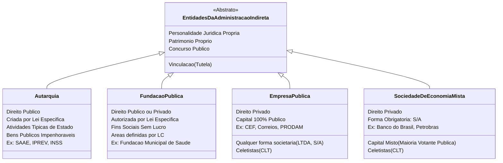

# Conhecimentos Específicos — Semana 02: Organização Administrativa Básica

> **Cargo-Alvo:** Oficial Administrativo — Concurso Municipal  
> **Tema Central:** Organização Administrativa: Centralização vs. Descentralização (Outorga e Delegação); Concentração vs. Desconcentração; Administração Direta e Indireta (Autarquias, Fundações, Empresas Públicas e Sociedades de Economia Mista).  
> **Método:** A História Real de uma Prefeitura (Visão Prática do Oficial Administrativo na Repartição) com Sínteses Feynman e Quadros Comparativos.  
> **Material de Apoio e Treino:** Teoria Completa Passo a Passo + 10 Questões Reais da Banca Instituto ACCESS comentadas alternativa por alternativa.

---

## 🏛️ PRÓLOGO: O Primeiro Dia do Oficial Administrativo na Repartição

Imagine a seguinte cena: você acabou de tomar posse como **Oficial Administrativo** na Prefeitura Municipal. Você entra pelo prédio sede do Paço Municipal, cumprimenta a recepcionista e é encaminhado para a sua mesa no **Setor de Protocolo e Expediente**, subordinado à **Secretaria Municipal de Administração**.

Na sua primeira manhã de trabalho, chegam à sua mesa três processos com demandas completamente diferentes:

1. **Processo nº 101/2026:** Um munícipe solicitando certidão de numeração predial para averbação de um imóvel. A análise deve ser feita pela Secretaria Municipal de Obras e Urbanismo.
2. **Processo nº 102/2026:** Um memorando vindo do **SAAE (Serviço Autônomo de Água e Esgoto)**, pedindo certidão de regularidade cadastral para uma licitação própria.
3. **Processo nº 103/2026:** Um requerimento de um consórcio privado de empresas de ônibus que opera as linhas municipais de transporte coletivo, pedindo revisão contratual da tarifa.

Se você olhar desavisado para essas três pastas, pode achar que tudo é simplesmente "a Prefeitura". Mas o Direito Administrativo nos ensina que há engrenagens jurídicas completamente distintas operando por trás de cada uma delas:
* O primeiro caso ocorre dentro do mesmo CNPJ da Prefeitura, circulando entre suas divisões internas (**Desconcentração** dentro da **Administração Direta**).
* O segundo caso envolve uma pessoa jurídica criada por lei municipal para cuidar exclusivamente de saneamento, com autonomia financeira e administrativa própria (**Descentralização por Outorga** criando uma **Autarquia** na **Administração Indireta**).
* O terceiro caso envolve a transferência da execução de um serviço público municipal para empresas privadas através de contrato de concessão (**Descentralização por Delegação/Colaboração** com particulares).

Neste guia, você vai entender com precisão cirúrgica cada uma dessas engrenagens. Nunca mais você confundirá os pares de palavras que as bancas de concurso — especialmente o **Instituto ACCESS** — adoram trocar para induzir o candidato desatento ao erro.

---

## 🧭 MAPA GERAL DA ORGANIZAÇÃO DO ESTADO

Antes de aprofundar, observe este mapa mental estrutural. Todo o assunto da nossa semana cabe nesta organização visual:

---

## 📌 EIXO 1: Centralização vs. Descentralização — Quem Presta o Serviço?

O ponto de partida do Direito Administrativo é responder: **o Poder Público vai realizar a tarefa sozinho ou vai repassar a atividade para outra pessoa jurídica?**

### 1. Centralização Administrativa (O Município Faz Sozinho)
* **Conceito:** Ocorre quando o próprio ente político (no nosso caso, o **Município**) executa diretamente os serviços públicos por meio de seus próprios órgãos e agentes públicos, utilizando a sua própria estrutura.
* **Exemplo Real na Prefeitura:** O Prefeito, através da Secretaria Municipal de Finanças e seus auditores fiscais municipais, realiza a cobrança e a fiscalização do IPTU e do ISS. Não existe outra empresa ou autarquia no meio do caminho: é o Município arrecadando o seu próprio imposto por meio de seus servidores concursados.
* **Características:**
  1. Há apenas **uma pessoa jurídica** atuando (o Município, com seu CNPJ principal).
  2. A responsabilidade por qualquer dano ou falha é diretamente atribuída ao ente federativo.

---

### 2. Descentralização Administrativa (O Município Transfere para Outra Pessoa)
* **Conceito:** Ocorre quando a Administração Centralizada transfere a competência para **outra pessoa jurídica** (pública ou privada), para que esta execute o serviço público de forma autônoma.
* **Atenção:** Na descentralização, **SEMPRE** existem pelo menos **duas pessoas jurídicas diferentes** envolvidas: o ente central (Município) e a entidade executora (uma Autarquia, uma Empresa Pública ou uma Concessionária privada).

A descentralização administrativa se divide em duas grandes espécies consagradas pela doutrina e cobradas com rigor pela banca ACCESS:

#### A) Descentralização por Serviços, Funcional, Técnica ou por Outorga
* **Como ocorre:** Ocorre por meio de **LEI**. O Poder Legislativo aprova uma lei municipal (de iniciativa do Prefeito) que cria ou autoriza uma entidade da **Administração Indireta** (uma Autarquia, uma Fundação Pública, uma Empresa Pública ou uma Sociedade de Economia Mista).
* **O que é transferido:** Transfere-se tanto a **titularidade** quanto a **execução** do serviço público (no caso das pessoas de direito público, como as autarquias) ou a execução e gestão técnica.
* **Exemplo Real na Prefeitura:** A Câmara de Vereadores aprova uma lei criando o **SAAE (Serviço Autônomo de Água e Esgoto)** com personalidade jurídica autárquica. A partir da lei, o SAAE tem seu próprio CNPJ, seus próprios servidores concursados, sua sede própria e seu orçamento independente. Se a água faltar por falha operacional, o munícipe processa o SAAE, e não a Prefeitura diretamente.

#### B) Descentralização por Colaboração ou por Delegação
* **Como ocorre:** Ocorre por meio de **CONTRATO ADMINISTRATIVO** (concessão ou permissão) ou por **ATO ADMINISTRATIVO UNILATERAL** (autorização de serviço público), após processo licitatório.
* **Para quem vai:** Para **particulares** (pessoas físicas ou jurídicas de direito privado da iniciativa privada).
* **O que é transferido:** Transfere-se **APENAS A EXECUÇÃO** temporária do serviço! A **titularidade** do serviço público continua 100% nas mãos do Município! O Município não abre mão de ser o dono do serviço; ele apenas contrata um terceiro para operá-lo no dia a dia.
* **Exemplo Real na Prefeitura:** O transporte público coletivo de passageiros. A Prefeitura realiza uma licitação e assina um contrato de concessão com a empresa "Viação Cidade Limpa Ltda." por 15 anos. A empresa compra os ônibus, contrata os motoristas e cobra a tarifa. Mas a linha de ônibus continua sendo municipal: a Prefeitura fiscaliza os horários, define os trajetos e pode aplicar multas se os ônibus atrasarem.

---

### ⚠️ A Regra de Ouro da Descentralização: NÃO HÁ HIERARQUIA!
Este é o ponto mais cobrado em provas:
> **Entre o Município e a entidade descentralizada NÃO existe subordinação hierárquica!**

Pense na lógica: se a Prefeitura deu autonomia jurídica para o SAAE ou para a empresa de ônibus, o Prefeito não pode simplesmente ligar para o presidente do SAAE e dar uma ordem de serviço direta como se ele fosse seu subalterno de setor, nem pode rever de ofício todos os despachos internos da autarquia.
* **O que existe então?** Existe **VINCULAÇÃO**, chamada pelo Direito de **TUTELA ADMINISTRATIVA**, **SUPERVISÃO FINALÍSTICA** ou **CONTROLE TELEOLÓGICO**.
* **Como funciona a Tutela:** A Prefeitura apenas fiscaliza se a entidade descentralizada está cumprindo as finalidades para as quais foi criada pela lei ou pelo contrato. Se o SAAE foi criado para cuidar de água e esgoto, a Prefeitura verifica se o serviço de saneamento está sendo prestado dentro dos padrões de qualidade e do orçamento aprovado, sem intervir na gestão interna cotidiana.

---

### 🔬 Síntese Feynman de 3 Linhas — Eixo 1
1. **Centralização:** O Município executa suas atividades sozinho, usando seus próprios funcionários e suas secretarias sob o mesmo CNPJ.
2. **Descentralização:** O Município transfere tarefas para outra pessoa jurídica: por **outorga legal** (cria a Administração Indireta) ou por **delegação contratual** (contrata particulares).
3. **Regra de prova:** Entre pessoas jurídicas diferentes nunca há hierarquia ou subordinação, apenas controle finalístico (vinculação/tutela).

---

## 📌 EIXO 2: Concentração vs. Desconcentração — A Divisão Interna por Órgãos

Agora vamos descer um degrau na estrutura. Esqueça a criação de novas empresas ou autarquias. Vamos olhar exclusivamente para **dentro da Prefeitura**.

### 1. Concentração Administrativa (Tudo na Cabeça da Pirâmide)
* **Conceito:** Ocorre quando as atribuições administrativas são reunidas e exercidas exclusivamente no topo da organização, em uma única unidade decisória, sem divisão de competências.
* **A metáfora prática:** Imagine se o Prefeito Municipal tivesse que, pessoalmente, assinar cada atestado de óbito do cemitério, conferir cada nota fiscal de compra de lápis, carimbar cada entrada de protocolo e autorizar a troca de lâmpada de cada poste da cidade. A cidade pararia no primeiro dia. Essa seria a concentração pura.
* **Consequência:** Inviabilidade prática em administrações modernas.

---

### 2. Desconcentração Administrativa (A Divisão em Departamentos e Seções)
* **Conceito:** É a técnica de divisão interna de competências **dentro de uma mesma pessoa jurídica**. Para que o trabalho flua com agilidade e especialização técnica, o Município reparte suas atribuições em várias unidades de trabalho chamadas **ÓRGÃOS PÚBLICOS**.
* **O Macete Mnemônico Infalível:**
  * Des**CON**centração $\rightarrow$ Cria **Ó**rgãos! (Lembre-se da letra **O** em desconcentração e órgão).
  * Des**CEN**tralização $\rightarrow$ Cria **E**ntidades! (Lembre-se da letra **E** em descentralização e entidade).
* **Exemplo Real na Prefeitura:** O Prefeito cria a *Secretaria Municipal de Finanças*, a *Secretaria Municipal de Saúde*, o *Departamento de Compras*, a *Divisão de Recursos Humanos* e o *Setor de Protocolo Geral*. Todos esses setores pertencem à MESMA pessoa jurídica (o Município).

---

### 🧠 A Teoria do Órgão (Otto Gierke) e a Imputação Volitiva
Por que você, Oficial Administrativo, precisa entender o que é um órgão?
Porque isso define a sua responsabilidade civil e jurídica no balcão de atendimento:

1. **Órgão NÃO tem personalidade jurídica própria:** Um órgão não tem CNPJ próprio, não tem patrimônio próprio, não pode ser dono de um carro da frota e não pode, em regra, ser réu em uma ação judicial de cobrança ou indenização.
2. **Teoria da Imputação Volitiva:** Criada pelo jurista alemão Otto Gierke e adotada pelo Brasil, essa teoria afirma que o Estado é como um corpo humano. Os órgãos públicos são os membros e as partes desse corpo. O servidor público é o ser humano que dá movimento a esses membros. Quando você, Oficial Administrativo, carimba e despacha uma certidão no Setor de Protocolo, não é o "Setor de Protocolo" que agiu, nem foi você na pessoa física: **quem agiu foi o Município!**
   * A vontade do agente público é **imputada** (transferida juridicamente) à pessoa jurídica que ele integra.
   * Se um munícipe tropeçar em um fio desencapado dentro do Protocolo da Prefeitura e quebrar a perna, ele não processa o "Setor de Protocolo" (órgão despersonalizado), nem processa o Oficial que estava na recepção: ele ajuíza a ação indenizatória em face do **Município de ...** (pessoa jurídica).

---

### 👑 Hierarquia e Subordinação: A Marca da Desconcentração
Diferente da descentralização, na desconcentração **EXISTE SUBORDINAÇÃO HIERÁRQUICA PLENA!**
Como todos estão debaixo do mesmo teto jurídico, a cadeia de comando é contínua e rígida:
* O Prefeito comanda o Secretário Municipal;
* O Secretário comanda o Diretor de Departamento;
* O Diretor de Departamento orienta o Chefe de Setor;
* O Chefe de Setor distribui o serviço e fiscaliza as tarefas do Oficial Administrativo.

Dessa relação de hierarquia decorrem poderes fundamentais:
* **Poder de dar ordens:** A chefia determina como as rotinas devem ser executadas.
* **Poder de fiscalizar e rever atos:** A autoridade superior pode anular atos ilegais ou revogar atos inoportunos praticados por seus subordinados.
* **Poder de delegar e avocar competências:** Transferir temporariamente uma tarefa para o escalão inferior ou puxar para si uma decisão que caberia ao subordinado.
* **Poder disciplinar:** Aplicar penalidades disciplinares aos servidores que descumprirem seus deveres funcionais, após regular processo administrativo.

---

### 🏷️ Classificação Doutrinária dos Órgãos Públicos (Hely Lopes Meirelles)
As bancas cobram a clássica classificação dos órgãos quanto à sua posição estatal:

| Categoria | Descrição e Autonomia | Exemplos no Município / Federação |
| :--- | :--- | :--- |
| **Órgãos Independentes** | Estão no topo constitucional. Têm competências originárias da própria Constituição Federal e **não se subordinam a ninguém**. | Câmara Municipal de Vereadores, Presidência da República, Congresso Nacional, Supremo Tribunal Federal. |
| **Órgãos Autônomos** | Situam-se na cúpula administrativa, imediatamente abaixo dos órgãos independentes. Têm ampla autonomia administrativa, técnica e financeira. | Secretarias Municipais (Secretaria de Educação, de Saúde, etc.), Ministérios. |
| **Órgãos Superiores** | Têm poder de direção, controle e decisão técnica sobre assuntos de sua competência, mas são subordinados a uma chefia mais alta. | Coordenadorias, Departamentos, Divisões (ex: Departamento de Tributação). |
| **Órgãos Subalternos** | Encontram-se na base da pirâmide. Exercem funções de **mera execução mecânica e rotineira**, sem poder de decisão política. | Setor de Protocolo, Seção de Almoxarifado, Portaria, Zeladoria. |

---

### 🔬 Síntese Feynman de 3 Linhas — Eixo 2
1. **Desconcentração:** É a divisão interna de tarefas dentro da mesma pessoa jurídica, criando secretarias, departamentos e setores de expediente.
2. **Órgão público:** É uma unidade despersonalizada (sem CNPJ próprio) cujos atos e vontades são juridicamente imputados ao Município.
3. **Regra de ouro:** Onde há desconcentração, sempre existe hierarquia, dever de obediência e subordinação direta à chefia superior.

---

## 📌 EIXO 3: O Grande Duelo de Prova — Desconcentração vs. Descentralização

As bancas examinadoras sabem que essas duas palavras começam com "Des" e possuem sons semelhantes. Mais de 40% dos erros dos candidatos em provas de nível médio ocorrem porque eles trocam esses dois conceitos.

Guarde este quadro comparativo definitivo na sua mente:

| Critério de Comparação | DESCONCENTRAÇÃO | DESCENTRALIZAÇÃO |
| :--- | :--- | :--- |
| **Quantas Pessoas Jurídicas?** | **Apenas UMA pessoa jurídica.** A divisão ocorre no âmbito interno. | **DUAS ou mais pessoas jurídicas.** Envolve o ente criador e a entidade receptora. |
| **O que é criado?** | **ÓRGÃOS públicos** (Secretarias, Departamentos, Setores). | **ENTIDADES da Indireta** (Autarquias, Empresas Públicas) ou transferência a **Particulares**. |
| **Existe Hierarquia?** | **SIM.** Existe subordinação direta, dever de obediência e poder disciplinar. | **NÃO.** Existe apenas controle finalístico, tutela administrativa ou supervisão ministerial. |
| **Instrumento de Criação** | Lei ou ato administrativo interno de organização estrutural. | **Lei específica** (outorga para a Indireta) ou **Contrato/Ato** (delegação para particulares). |
| **Exemplo Prático na Prefeitura** | O Prefeito cria a *Divisão de Arquivo Central* vinculada à Secretaria de Administração. | O Município cria por lei o *Instituto Municipal de Previdência (IPREV)*. |
| **Pegadinha Clássica de Banca** | Afirmar que a criação de uma autarquia é desconcentração. *(FALSO: é descentralização).* | Afirmar que o Prefeito exerce poder hierárquico sobre o presidente de uma empresa pública. *(FALSO: exerce apenas tutela).* |

---

### 🔬 Síntese Feynman de 3 Linhas — Eixo 3
1. **Desconcentração = 1 Pessoa Jurídica:** Divide o trabalho internamente entre órgãos subordinados hierarquicamente.
2. **Descentralização = 2 Pessoas Jurídicas:** Transfere a competência para outra entidade autônoma, sem subordinação hierárquica.
3. **Gatilho de prova:** Falou em "órgão ou repartição interna", marque desconcentração; falou em "criação de nova entidade com personalidade jurídica", marque descentralização.

---

## 📌 EIXO 4: Administração Direta — O Núcleo Político do Estado

A Administração Pública brasileira divide-se constitucionalmente em **Direta** e **Indireta** (art. 37 da Constituição Federal de 1988 e art. 4º do Decreto-Lei nº 200/1967).

### Quem compõe a Administração Direta?
A Administração Direta é formada exclusivamente pelos **entes federativos** (as pessoas políticas):
1. **União** (representada pelo Governo Federal: Presidência da República e Ministérios);
2. **Estados** (representados pelos Governos Estaduais e Secretarias de Estado);
3. **Distrito Federal**;
4. **Municípios** (representados pela Prefeitura Municipal, Gabinete do Prefeito e Secretarias Municipais).

### Por que são chamadas de "Pessoas Políticas"?
Porque elas recebem suas competências diretamente do texto da Constituição Federal e possuem autonomia plena:
* **Autonomia Política:** Capacidade de escolher seus próprios governantes por voto popular (Prefeito e Vereadores).
* **Autonomia Legislativa:** Capacidade de produzir suas próprias leis (Leis Municipais votadas pela Câmara de Vereadores).
* **Autonomia Administrativa e Financeira:** Capacidade de organizar seus serviços e instituir seus próprios tributos (IPTU, ISS, Taxas de fiscalização).

### O Regime Jurídico da Administração Direta
A Administração Direta atua sob o **Regime Jurídico-Administrativo de Direito Público**. Isso confere ao ente público prerrogativas especiais que empresas privadas comuns jamais teriam:
* **Imunidade Tributária Recíproca (art. 150, VI, "a", CF/88):** A Prefeitura não paga IPTU nem IPVA para o Estado ou para a União sobre seus veículos e prédios próprios, e vice-versa.
* **Impenhorabilidade de Bens Públicos:** Se a Prefeitura for condenada em uma ação judicial e dever dinheiro a um cidadão, o juiz **não pode** penhorar um computador do setor de expediente nem confiscar um caminhão de lixo. A cobrança contra a Fazenda Pública segue a fila constitucional de **precatórios judiciais** ou Requisições de Pequeno Valor (RPV).
* **Regime de Pessoal:** Servidores públicos estatutários, admitidos exclusivamente por **concurso público de provas ou de provas e títulos** (art. 37, II, CF), com direito à estabilidade após três anos de efetivo exercício e aprovação em avaliação especial de desempenho.
* **Contratações:** Todas as compras de materiais, insumos de expediente e obras dependem, em regra, de processo licitatório prévio (Lei nº 14.133/2021).

---

### 🔬 Síntese Feynman de 3 Linhas — Eixo 4
1. **Administração Direta:** É o núcleo estatal formado pela União, Estados, DF e Municípios, exercendo funções de forma centralizada.
2. **Personalidade política:** Possuem autonomia legislativa, política e financeira, atuando sob regime 100% de direito público.
3. **Prerrogativas exclusivas:** Seus bens são impenhoráveis, possuem imunidade tributária e seus pagamentos judiciais seguem a fila de precatórios.

---

## 📌 EIXO 5: Administração Indireta — A Anatomia das Quatro Entidades

Quando a máquina da Administração Direta fica sobrecarregada ou quando determinada atividade exige uma flexibilidade técnica ou empresarial que o modelo burocrático tradicional da Prefeitura não consegue oferecer com agilidade, o Município **descentraliza** a atividade por lei, criando a **ADMINISTRAÇÃO INDIRETA**.

### O Mnemônico Universal: F-A-S-E
A Administração Indireta brasileira é composta **exclusivamente por quatro tipos de entidades**:
* **F** $\rightarrow$ **Fundações Públicas**
* **A** $\rightarrow$ **Autarquias**
* **S** $\rightarrow$ **Sociedades de Economia Mista**
* **E** $\rightarrow$ **Empresas Públicas**

Não existe nenhuma outra entidade fora dessas quatro na Administração Indireta. Concessionárias de ônibus privadas, ONGs e Organizações Sociais (OS) **NÃO** fazem parte da Administração Indireta (são particulares em colaboração com o poder público).

---

### As Regras Constitucionais de Criação (Art. 37, XIX, da CF/88)
Preste muita atenção nesta redação constitucional, porque o Instituto ACCESS cobra a literalidade desse texto:

> *"Somente por lei específica poderá ser **criada autarquia** e **autorizada a instituição** de empresa pública, de sociedade de economia mista e de fundação, cabendo à lei complementar, neste último caso, definir as áreas de sua atuação."* (CF/88, art. 37, XIX)

Percebeu a sutileza gramatical e jurídica?
1. **A Autarquia é a ÚNICA que é CRIADA DIRETAMENTE PELA LEI:** A lei nasce, a autarquia já existe no mesmo instante. Não precisa ir a cartório nem registrar nada.
2. **Empresas Públicas, Sociedades de Economia Mista e Fundações Públicas de Direito Privado têm a sua instituição apenas AUTORIZADA POR LEI:** A lei autoriza o Prefeito a criá-las. A criação de fato só acontece quando o Poder Executivo elabora os estatutos e faz o registro dos atos constitutivos no Cartório de Registro Civil de Pessoas Jurídicas ou na Junta Comercial.
3. **Fundações Públicas:** Além da lei autorizativa, exige-se **lei complementar** para definir as áreas de sua atuação (saúde, cultura, pesquisa, assistência social).

---

### O Raio-X Detalhado das 4 Entidades

---

#### 1. Autarquias (O "Clone" da Administração Direta)
* **Personalidade Jurídica:** Pessoa jurídica de **Direito Público**.
* **Como nasce:** Criada diretamente por lei específica.
* **Finalidade:** Execução de **atividades típicas de Estado**, que exigem autoridade estatal, poder de fiscalização ou serviços públicos indelegáveis.
* **Patrimônio e Bens:** Seus bens são considerados **bens públicos** (são inalienáveis, impenhoráveis, imprescritíveis e gozam de imunidade tributária recíproca).
* **Regime de Pessoal:** Em regra, servidores estatutários (regime jurídico único), com concurso público e estabilidade.
* **Exemplos Reais no Município:**
  * **SAAE** (Serviço Autônomo de Água e Esgoto);
  * **IPREV / PREVIM** (Instituto de Previdência dos Servidores Públicos Municipais);
  * Na esfera federal: INSS, IBAMA, ANATEL, Universidades Federais.

#### 2. Fundações Públicas
* **Personalidade Jurídica:** Pode ter personalidade de **Direito Público** (quando criada diretamente por lei como "autarquia fundacional") ou de **Direito Privado** (quando autorizada por lei específica e registrada em cartório).
* **Finalidade:** Atividades de **interesse social, científico, cultural, educacional ou de saúde**, sempre **SEM FINALIDADE LUCRATIVA**.
* **Áreas de atuação:** Exigem que uma **Lei Complementar** defina suas áreas de atuação (art. 37, XIX, CF/88).
* **Exemplo Real no Município:** Fundação Municipal de Cultura e Arte, Fundação Municipal de Saúde.

#### 3. Empresas Públicas (EP)
* **Personalidade Jurídica:** Pessoa jurídica de **Direito Privado**.
* **Como nasce:** Instituição **autorizada por lei específica**, com criação consumada pelo registro na Junta Comercial.
* **Composição do Capital:** O capital social é **100% PÚBLICO** (pode pertencer exclusivamente ao Município ou admitir participação de outros órgãos públicos, como Estado e União, mas **zero centavo** de dinheiro privado).
* **Forma Societária:** Pode adotar **QUALQUER formato societário** admitido em direito: pode ser Sociedade Limitada (Ltda.), Sociedade Anônima (S/A), Empresa Individual de Responsabilidade Limitada, etc.
* **Regime de Pessoal:** Empregados públicos contratados pelo regime da **CLT** (celetistas), mas obrigatoriamente aprovados em **concurso público** (art. 37, II, CF).
* **Exemplos:**
  * No Município: Empresa Municipal de Processamento de Dados (PRODAM), Empresa Municipal de Urbanização (EMURB).
  * Na União: Caixa Econômica Federal (CEF), Empresa Brasileira de Correios e Telégrafos (ECT).

#### 4. Sociedades de Economia Mista (SEM)
* **Personalidade Jurídica:** Pessoa jurídica de **Direito Privado**.
* **Como nasce:** Instituição **autorizada por lei específica**, com registro mercantil.
* **Composição do Capital:** O capital é **MISTO**, ou seja, reúne dinheiro público e dinheiro de investidores particulares da iniciativa privada.
  * **Condição Obrigatória:** A **maioria das ações com direito a voto** (capital votante) deve pertencer, obrigatoriamente, ao Poder Público.
* **Forma Societária OBRIGATÓRIA:** Só pode ser constituída sob a forma de **SOCIEDADE ANÔNIMA (S/A)**. Nunca pode ser Limitada (Ltda.)!
* **Regime de Pessoal:** Empregados celetistas (CLT), mediante concurso público.
* **Exemplos:**
  * Na União: Banco do Brasil (S/A), Petrobras (S/A).
  * Nos Estados: Companhia de Saneamento Básico (SABESP, COPASA).
  * Nos Municípios: Companhias de economia mista de armazéns ou transporte urbano.

---

### ⚖️ O Regime Jurídico Híbrido das Empresas Estatais
Empresas Públicas e Sociedades de Economia Mista são genericamente chamadas de **Empresas Estatais**.
Muitas bancas tentam fazer a seguinte pegadinha: *"Como as estatais são pessoas jurídicas de direito privado, seus dirigentes têm liberdade total para contratar quem quiserem sem concurso e comprar de qualquer fornecedor sem licitação."*
> **ISSO É COMPLETAMENTE FALSO!**

As empresas estatais submetem-se a um **REGIME JURÍDICO HÍBRIDO (MISTO)**:
1. **Lado Privado:** Têm agilidade gerencial, contratam empregados sob a CLT, firmam contratos de direito privado e podem competir no mercado econômico.
2. **Lado Público (Vinculação Constitucional):**
   * Seus funcionários só entram por **concurso público**;
   * Suas compras e contratos devem seguir o Estatuto Jurídico das Empresas Estatais (Lei Federal nº 13.303/2016);
   * São fiscalizadas diretamente pelo Tribunal de Contas;
   * Estão 100% sujeitas aos princípios do art. 37, caput, da CF/88 (**Legalidade, Impessoalidade, Moralidade, Publicidade e Eficiência**);
   * Seus dirigentes não podem usar a imagem da empresa para autopromoção pessoal (violação da impessoalidade).

---

### 📊 TABELA COMPARATIVA DEFINITIVA DA ADMINISTRAÇÃO INDIRETA

| Entidade | Personalidade Jurídica | Criação | Composição do Capital | Forma Societária | Regime de Pessoal |
| :--- | :--- | :--- | :--- | :--- | :--- |
| **Autarquia** | **Direito Público** | **Criada diretamente por lei específica** | 100% Público (Patrimônio Próprio) | Forma Própria de Direito Público | Estatutário (regra geral) |
| **Fundação Pública** | **Direito Público ou Privado** | Criada por lei (pública) ou Autorizada por lei (privada) | 100% Público (Dotação Patrimonial) | Fundação (sem fins lucrativos) | Estatutário ou CLT |
| **Empresa Pública** | **Direito Privado** | **Autorizada por lei específica** + Registro | **100% Público** (Município, Estado, União) | **Qualquer forma societária** (Ltda., S/A) | **CLT** (Concurso Público) |
| **Sociedade de Economia Mista** | **Direito Privado** | **Autorizada por lei específica** + Registro | **Misto** (Maioria do voto pública + Particulares) | **Apenas S/A** (Sociedade Anônima) | **CLT** (Concurso Público) |

---

### 🔬 Síntese Feynman de 3 Linhas — Eixo 5
1. **Administração Indireta (FASE):** Quatro entidades com personalidade jurídica própria, criadas para executar serviços especializados descentralizados.
2. **Autarquia vs. Estatais:** A Autarquia é de direito público e criada diretamente por lei; Empresa Pública e Sociedade de Economia Mista são de direito privado e apenas autorizadas por lei.
3. **EP vs. SEM:** Empresa Pública aceita qualquer formato empresarial e tem capital 100% público; Sociedade de Economia Mista é obrigatoriamente S/A e mistura capital público e privado.

---

## 📌 EIXO 6: A Lei nº 9.784/1999 e a Tríade: Órgão, Entidade e Autoridade

Para fechar o bloco conceitual com chave de ouro, todo Oficial Administrativo deve saber recitar o artigo 1º, § 2º, da Lei Federal de Processo Administrativo (Lei nº 9.784/1999). As bancas trocam as definições entre si:

> **Art. 1º, § 2º, da Lei nº 9.784/1999:**
> * **I - Órgão:** a unidade de atuação integrante da estrutura da Administração direta e da estrutura da Administração indireta;
> * **II - Entidade:** a unidade de atuação dotada de personalidade jurídica;
> * **III - Autoridade:** o servidor ou agente público dotado de poder de decisão.

Preste atenção em três detalhes vitais para sua prova:
1. **A Administração Indireta também tem órgãos!** Uma autarquia como o SAAE possui seu próprio departamento financeiro, sua própria gerência de saneamento e sua própria divisão de atendimento ao consumidor. Todos esses setores internos da autarquia são órgãos da Administração Indireta.
2. **Entidade é quem tem CNPJ próprio e personalidade jurídica:** O Município é uma entidade (política); o SAAE é uma entidade (autárquica); a PRODAM é uma entidade (empresarial).
3. **Autoridade é a pessoa física com caneta na mão:** O Prefeito, o Secretário Municipal e o Diretor de Departamento são autoridades públicas porque a lei lhes confere o poder de expedir decisões vinculantes.

---

### 🔬 Síntese Feynman de 3 Linhas — Eixo 6
1. **Entidade:** Unidade com personalidade jurídica própria e patrimônio autônomo (Município ou Entidade da Indireta).
2. **Órgão:** Unidade interna de atuação despersonalizada, presente tanto na Administração Direta quanto na Indireta.
3. **Autoridade:** A pessoa física (servidor ou dirigente) que detém a competência legal expressa para emitir ordens e tomar decisões.

---

## 📝 SEÇÃO DE FIXAÇÃO PRÁTICA: 10 QUESTÕES REAIS DA BANCA INSTITUTO ACCESS

As 10 questões a seguir foram extraídas de concursos reais organizados pelo **Instituto ACCESS** para cargos administrativos de Prefeituras, Câmaras e Conselhos. Resolva cada uma com atenção antes de abrir o gabarito comentado!

---

### Questão 01
**Banca:** Instituto ACCESS  
**Órgão:** Prefeitura Municipal de Passos / MG  
**Ano:** 2023  
**Cargo:** Oficial de Administração  

Nela, as atribuições são divididas entre órgãos públicos pertencentes a uma única pessoa jurídica, mantendo-se a vinculação hierárquica.  
Trata-se de  
(A) concentração.  
(B) desconcentração.  
(C) centralização.  
(D) descentralização.  

<b>Ver Gabarito e Comentário Detalhado</b>

**Gabarito Oficial: B**

**Análise Detalhada Passo a Passo:**
* **Alternativa (B) CORRETA:** O enunciado traz a definição exata e literal de **desconcentração administrativa**: distribuição interna de atribuições e competências entre **órgãos públicos** que pertencem a uma **única pessoa jurídica**, mantendo-se a relação de subordinação e hierarquia direta entre a chefia e os subordinados. Lembre-se do nosso mnemônico: Des**CON**centração cria **Ó**rgãos!
* **Alternativa (A) INCORRETA:** Concentração é a ausência de divisão interna de competências, acumulando todas as atribuições em um único centro de decisão no topo da pirâmide organizacional.
* **Alternativa (C) INCORRETA:** Centralização é a execução das atividades administrativas pelo próprio ente político (o Município), mas o enunciado fala especificamente da divisão interna de atribuições entre órgãos subordinados hierarquicamente.
* **Alternativa (D) INCORRETA:** Descentralização exige a presença de **duas ou mais pessoas jurídicas distintas**, inexistindo subordinação hierárquica entre elas.

---

### Questão 02
**Banca:** Instituto ACCESS  
**Órgão:** Prefeitura Municipal de Passos / MG  
**Ano:** 2023  
**Cargo:** Oficial de Administração  

É constituída por órgãos que fazem parte da estrutura das pessoas federativas (pessoas políticas) que exercem a atividade administrativa de forma centralizada.  
Trata-se da  
(A) Administração Direta.  
(B) Administração Indireta.  
(C) Autarquia.  
(D) Sociedade de Economia Mista.  

<b>Ver Gabarito e Comentário Detalhado</b>

**Gabarito Oficial: A**

**Análise Detalhada Passo a Passo:**
* **Alternativa (A) CORRETA:** A Administração Direta é exatamente o conjunto de órgãos que integram as pessoas políticas federativas (União, Estados, Distrito Federal e Municípios), as quais desempenham as atividades estatais de forma centralizada. O Gabinete do Prefeito e as Secretarias Municipais são exemplos clássicos dessa estrutura.
* **Alternativa (B) INCORRETA:** A Administração Indireta é formada por pessoas jurídicas distintas (entidades descentralizadas: autarquias, fundações, empresas públicas e sociedades de economia mista), não atuando de forma centralizada pelo ente político.
* **Alternativas (C) e (D) INCORRETAS:** Autarquias e Sociedades de Economia Mista são espécies de entidades da Administração Indireta, dotadas de personalidade jurídica própria.

---

### Questão 03
**Banca:** Instituto ACCESS  
**Órgão:** Prefeitura Municipal de Cataguases / MG  
**Ano:** 2024  
**Cargo:** Oficial Administrativo / Agente Administrativo  

Quando a Administração distribui competências dentro dela mesma, ocorre  
(A) concentração.  
(B) desconcentração.  
(C) centralização.  
(D) descentralização.  

<b>Ver Gabarito e Comentário Detalhado</b>

**Gabarito Oficial: B**

**Análise Detalhada Passo a Passo:**
* **Alternativa (B) CORRETA:** Preste atenção na expressão-chave: *"dentro dela mesma"*. Se a competência é distribuída dentro da própria pessoa jurídica (internamente), trata-se de **desconcentração**. A Administração cria secretarias, diretorias e seções para organizar internamente seus processos de trabalho.
* **Alternativa (A) INCORRETA:** A concentração acumula competências no órgão de cúpula, sem distribuição interna.
* **Alternativa (C) INCORRETA:** Centralização indica que a atividade é feita pelo ente federativo, mas a ação de repartir competências internas chama-se desconcentração.
* **Alternativa (D) INCORRETA:** Na descentralização, as competências são distribuídas para **fora**, ou seja, para outra pessoa jurídica criada ou contratada.

---

### Questão 04
**Banca:** Instituto ACCESS  
**Órgão:** Prefeitura Municipal de Cataguases / MG  
**Ano:** 2024  
**Cargo:** Oficial Administrativo / Agente Administrativo  

Não há relação hierárquica entre as pessoas jurídicas. Isso ocorre na  
(A) concentração.  
(B) desconcentração.  
(C) centralização.  
(D) descentralização.  

<b>Ver Gabarito e Comentário Detalhado</b>

**Gabarito Oficial: D**

**Análise Detalhada Passo a Passo:**
* **Alternativa (D) CORRETA:** Na **descentralização**, a atuação ocorre entre pessoas jurídicas distintas (ex: o Município e o SAAE; ou o Município e a concessionária de transporte). Por serem pessoas jurídicas autônomas, **não existe subordinação ou hierarquia** entre elas, apenas vinculação, tutela administrativa ou supervisão ministerial finalística.
* **Alternativas (A) e (B) INCORRETAS:** Concentração e desconcentração ocorrem dentro de uma única pessoa jurídica. Na desconcentração, existe relação hierárquica direta entre os órgãos e agentes.
* **Alternativa (C) INCORRETA:** Na centralização, o ente central atua sozinho por seus próprios órgãos, havendo ampla hierarquia interna.

---

### Questão 05
**Banca:** Instituto ACCESS  
**Órgão:** Prefeitura Municipal de Cataguases / MG  
**Ano:** 2024  
**Cargo:** Oficial Administrativo / Agente Administrativo  

A descentralização pode ser efetivada por  
(A) outorga (concedida por ato administrativo) ou delegação.  
(B) outorga (criada por lei) ou delegação.  
(C) outorga ou delegação (concedida mediante autorização judicial).  
(D) outorga (mediante contrato administrativo) ou delegação (criada por lei).  

<b>Ver Gabarito e Comentário Detalhado</b>

**Gabarito Oficial: B**

**Análise Detalhada Passo a Passo:**
* **Alternativa (B) CORRETA:** A doutrina administrativa e a banca ACCESS consagram as duas modalidades básicas de descentralização:
  1. **Descentralização por Outorga (ou por Serviços/Legal):** Realizada obrigatoriamente por meio de **lei** que cria ou autoriza entidades da Administração Indireta (ex: autarquias).
  2. **Descentralização por Delegação (ou por Colaboração):** Realizada por meio de contrato administrativo (concessão ou permissão) ou ato unilateral (autorização) para pessoas jurídicas de direito privado da iniciativa privada.
* **Alternativa (A) INCORRETA:** A outorga não é concedida por ato administrativo, mas instituída por lei.
* **Alternativa (C) INCORRETA:** A descentralização não depende de intervenção ou autorização do Poder Judiciário.
* **Alternativa (D) INCORRETA:** Inverteu os institutos. A outorga dá-se por lei, e a delegação típica dá-se mediante contrato administrativo.

---

### Questão 06
**Banca:** Instituto ACCESS  
**Órgão:** Prefeitura Municipal de Cataguases / MG  
**Ano:** 2024  
**Cargo:** Oficial Administrativo / Agente Administrativo  

Não é [entidade] da Administração Indireta  
(A) Autarquia.  
(B) Fundação.  
(C) Ministério.  
(D) Sociedade de Economia Mista.  

<b>Ver Gabarito e Comentário Detalhado</b>

**Gabarito Oficial: C**

**Análise Detalhada Passo a Passo:**
* **Alternativa (C) CORRETA:** O **Ministério** (assim como a Secretaria Municipal no plano local) é um **órgão público despersonalizado pertencente à Administração Direta**, subordinado diretamente à Presidência da República (ou ao Prefeito, no caso de secretarias). Não é uma entidade da Administração Indireta.
* **Alternativas (A), (B) e (D) INCORRETAS:** Autarquias, Fundações Públicas e Sociedades de Economia Mista (ao lado das Empresas Públicas) compõem exatamente o quarteto (FASE) que forma a Administração Indireta.

---

### Questão 07
**Banca:** Instituto ACCESS  
**Órgão:** Câmara Municipal de Conquista / MG  
**Ano:** 2024  
**Cargo:** Assistente Legislativo  

Transfere-se a responsabilidade pela execução direta das ações para os órgãos especialistas, com pessoal treinado e apto para atuar de forma mais tempestiva sobre as questões específicas relacionadas à pasta.  
Trata-se de  
(A) descentralização.  
(B) desconcentração.  
(C) poder hierárquico.  
(D) delegação.  

<b>Ver Gabarito e Comentário Detalhado</b>

**Gabarito Oficial: B**

**Análise Detalhada Passo a Passo:**
* **Alternativa (B) CORRETA:** Observe a redação da banca: a transferência da execução ocorre para **"órgãos especialistas"** relacionados a uma **"pasta"** (secretaria ou departamento interno). Quando o poder público cria órgãos especializados dentro da mesma estrutura para agilizar o atendimento, temos formalmente o instituto da **desconcentração**.
* **Alternativa (A) INCORRETA:** A descentralização transfere competências para outras pessoas jurídicas (entidades ou particulares), e não para órgãos ou pastas internas.
* **Alternativa (C) INCORRETA:** O poder hierárquico é o instrumento de comando e subordinação existente dentro da desconcentração, mas o conceito descrito pelo enunciado é o processo organizativo da desconcentração em si.
* **Alternativa (D) INCORRETA:** Delegação transfere a execução para particulares ou outros entes, sem configurar repartição interna entre pastas ministeriais/secretarias.

---

### Questão 08
**Banca:** Instituto ACCESS  
**Órgão:** CRBio-08 (Conselho Regional de Biologia 8ª Região)  
**Ano:** 2023  
**Cargo:** Assistente Administrativo  

Com base na Lei 9.784/99, assinale a afirmativa incorreta.  
(A) Pela lei, autoridade é o servidor ou agente público dotado de poder de decisão.  
(B) Para os fins da lei, considera-se entidade a unidade de atuação integrante da estrutura da Administração direta e da estrutura da Administração indireta.  
(C) Pela lei, o órgão pode integrar a Administração direta ou indireta.  
(D) Os preceitos da lei também se aplicam aos órgãos dos Poderes Legislativo e Judiciário da União, quando no desempenho de função administrativa.  

<b>Ver Gabarito e Comentário Detalhado</b>

**Gabarito Oficial: B**

**Análise Detalhada Passo a Passo:**
* **Alternativa (B) INCORRETA (e gabarito da questão):** A afirmativa trocou o conceito legal! Segundo o art. 1º, § 2º, inciso II, da Lei nº 9.784/1999: *"considera-se **entidade** a unidade de atuação dotada de personalidade jurídica"*. A definição trazida na alternativa (*"unidade de atuação integrante da estrutura da Administração direta e da estrutura da Administração indireta"*) refere-se ao conceito de **ÓRGÃO** (art. 1º, § 2º, I). Como a banca pediu a incorreta, a alternativa (B) deve ser marcada.
* **Alternativa (A) CORRETA:** Reproduz fielmente o art. 1º, § 2º, III da lei: autoridade é o servidor ou agente público dotado de poder de decisão.
* **Alternativa (C) CORRETA:** Perfeito. Existem órgãos tanto na Direta (ex: Secretaria de Finanças) quanto na Indireta (ex: Diretoria Administrativa do SAAE).
* **Alternativa (D) CORRETA:** Reproduz o art. 1º, § 1º da lei: as normas do processo administrativo aplicam-se aos órgãos dos Poderes Legislativo e Judiciário quando no exercício de funções administrativas (funções atípicas).

---

### Questão 09
**Banca:** Instituto ACCESS  
**Órgão:** Conselho Regional de Medicina do Estado do Pará (CRM-PA)  
**Ano:** 2025  
**Cargo:** Assistente Administrativo  

Analise as assertivas a seguir, relativas à organização da Administração Pública brasileira:  
I. Órgãos da Administração direta não possuem personalidade jurídica própria, razão pela qual seus atos são imputados à pessoa política a que pertencem.  
II. Empresas públicas e sociedades de economia mista integram a Administração indireta e possuem personalidade jurídica própria, podendo adotar regime jurídico de direito privado, sem prejuízo da incidência de princípios da Administração Pública.  
III. As autarquias e as fundações públicas integram a estrutura da Administração direta, estando, por isso, sujeitas à subordinação hierárquica plena em relação aos ministérios.  
IV. A criação de entidades da Administração indireta depende, em regra, de lei específica.  

Assinale a alternativa que indica apenas as assertivas corretas:  
(A) I, III e IV.  
(B) I e II.  
(C) I, II e IV.  
(D) II e III.  

<b>Ver Gabarito e Comentário Detalhado</b>

**Gabarito Oficial: C**

**Análise Detalhada de Cada Assertiva:**
* **Assertiva I (VERDADEIRA):** Aplicação direta da Teoria do Órgão (Otto Gierke). Os órgãos não têm personalidade jurídica própria; seus atos volitivos são imputados diretamente à pessoa jurídica política à qual pertencem (União, Estado ou Município).
* **Assertiva II (VERDADEIRA):** Perfeita. Empresas Públicas e Sociedades de Economia Mista integram a Administração Indireta, têm personalidade jurídica própria de direito privado e submetem-se ao regime híbrido, respeitando expressamente os princípios constitucionais do art. 37 da CF/88.
* **Assertiva III (FALSA):** Erro duplo! Primeiro: autarquias e fundações públicas integram a Administração **Indireta** (e não a Direta). Segundo: não estão sujeitas à subordinação hierárquica plena em relação aos ministérios/secretarias, mas apenas à vinculação/tutela finalística.
* **Assertiva IV (VERDADEIRA):** Exato. Conforme o art. 37, XIX, da CF/88, a autarquia é criada por lei específica e as demais entidades da Administração Indireta têm sua criação autorizada por lei específica. Em todos os casos, a intervenção de lei específica é a regra geral.
* **Conclusão:** Estão corretas as assertivas **I, II e IV**, o que corresponde à alternativa **(C)**.

---

### Questão 10
**Banca:** Instituto ACCESS  
**Órgão:** Prefeitura Municipal de Promissão / SP  
**Ano:** 2026  
**Cargo:** Escriturário  

Um estado da federação instituiu, por meio de lei, entidade administrativa com personalidade jurídica de direito privado, destinada à execução de atividades de interesse público na área de tecnologia. A entidade passou a celebrar contratos com maior flexibilidade, adotar regime de pessoal próprio e captar recursos junto ao setor privado. Entretanto, auditoria interna apontou práticas como favorecimento de fornecedores, ausência de critérios objetivos na contratação e promoção institucional com vinculação direta à imagem de seus dirigentes.  

À luz dos princípios constitucionais da Administração Pública e da organização administrativa, analise as afirmativas a seguir:  
I. Ainda que possua personalidade jurídica de direito privado, a entidade está sujeita aos princípios constitucionais da Administração Pública, especialmente no que se refere à legalidade, impessoalidade, moralidade, publicidade e eficiência.  
II. A natureza jurídica de direito privado afasta a incidência dos princípios da Administração Pública, permitindo maior liberdade gerencial, inclusive quanto à escolha de fornecedores.  
III. A descentralização administrativa permite a criação de entidades com maior autonomia, mas não afasta o dever de observância dos princípios constitucionais e dos mecanismos de controle.  
IV. A promoção institucional que vincule a atuação administrativa à imagem de dirigentes públicos pode violar o princípio da impessoalidade, ainda que realizada por entidade da administração indireta.  
V. As entidades da administração indireta com personalidade jurídica de direito privado submetem-se a um regime jurídico híbrido, no qual coexistem normas de direito privado com a incidência de princípios e regras de direito público, especialmente quando atuam na prestação de serviços de interesse coletivo.  

Assinale a alternativa correta:  
(A) Apenas as afirmativas I, II e IV estão corretas.  
(B) As afirmativas I, II, III, IV e V estão corretas.  
(C) Apenas as afirmativas II, III e V estão corretas.  
(D) Apenas as afirmativas I, III, IV e V estão corretas.  

<b>Ver Gabarito e Comentário Detalhado</b>

**Gabarito Oficial: D**

**Análise Detalhada de Cada Afirmativa:**
* **Afirmativa I (VERDADEIRA):** O art. 37, caput, da CF/88 é categórico: os princípios expressos (LIMPE) aplicam-se à Administração Direta e Indireta de qualquer dos Poderes, independentemente de a entidade ter personalidade jurídica de direito público ou privado.
* **Afirmativa II (FALSA):** A personalidade jurídica de direito privado não autoriza favorecimento de fornecedores nem afasta os princípios públicos. Suas contratações devem respeitar critérios objetivos, impessoais e as regras da Lei nº 13.303/2016.
* **Afirmativa III (VERDADEIRA):** A descentralização confere autonomia técnica, financeira e administrativa, mas mantém a vinculação e a submissão aos princípios constitucionais e aos órgãos de controle (como o Tribunal de Contas).
* **Afirmativa IV (VERDADEIRA):** O art. 37, § 1º, da CF/88 proíbe expressamente que a publicidade de atos públicos conste nomes, símbolos ou imagens que caracterizem promoção pessoal de autoridades ou servidores, violando frontalmente a impessoalidade.
* **Afirmativa V (VERDADEIRA):** Síntese impecável da doutrina e da jurisprudência sobre o chamado **regime jurídico híbrido** das estatais e entidades privadas da Administração Indireta.
* **Conclusão:** Estão corretas **I, III, IV e V**, o que consolida o gabarito na alternativa **(D)**.

---

## 🎯 CHECKLIST DE REVISÃO RÁPIDA DO OFICIAL ADMINISTRATIVO

Antes de fechar os seus estudos da semana, passe os olhos neste checklist de memorização rápida:

- [ ] **Centralização:** O próprio ente federativo (Município) faz com seus próprios servidores e recursos.
- [ ] **Descentralização:** Transfere a competência para outra pessoa jurídica (por **outorga legal** para a Indireta ou por **delegação contratual** para particulares).
- [ ] **Concentração:** Todas as decisões e tarefas concentradas na cúpula (sem divisão interna).
- [ ] **Desconcentração:** Divisão interna de tarefas entre **órgãos** da mesma pessoa jurídica (**ó**rgão = desc**o**ncentração).
- [ ] **Hierarquia:** Existe na desconcentração (dentro do mesmo CNPJ). **NÃO existe** na descentralização (entre pessoas jurídicas diferentes).
- [ ] **Administração Direta:** União, Estados, DF e Municípios (pessoas políticas de direito público).
- [ ] **Administração Indireta (FASE):** Fundações, Autarquias, Sociedades de Economia Mista e Empresas Públicas.
- [ ] **Autarquia:** Criada diretamente por lei específica, personalidade de direito público, bens impenhoráveis.
- [ ] **Empresa Pública:** Autorizada por lei, direito privado, capital **100% público**, qualquer formato societário, CLT com concurso.
- [ ] **Sociedade de Economia Mista:** Autorizada por lei, direito privado, capital **misto** (maioria votante pública), **obrigatoriamente S/A**, CLT com concurso.
- [ ] **Art. 1º, § 2º da Lei 9.784/99:** Órgão = unidade de atuação despersonalizada; Entidade = pessoa jurídica dotada de personalidade; Autoridade = agente com poder de decisão.
